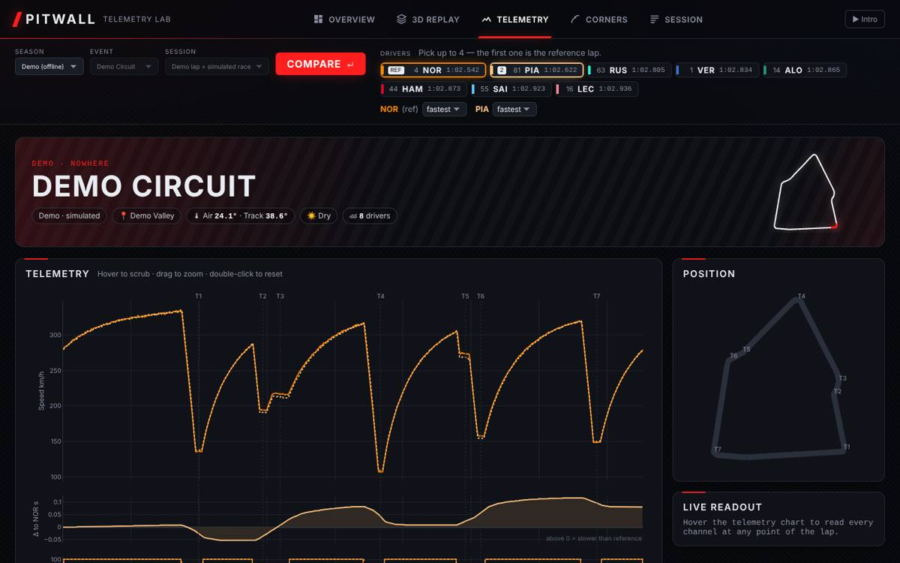
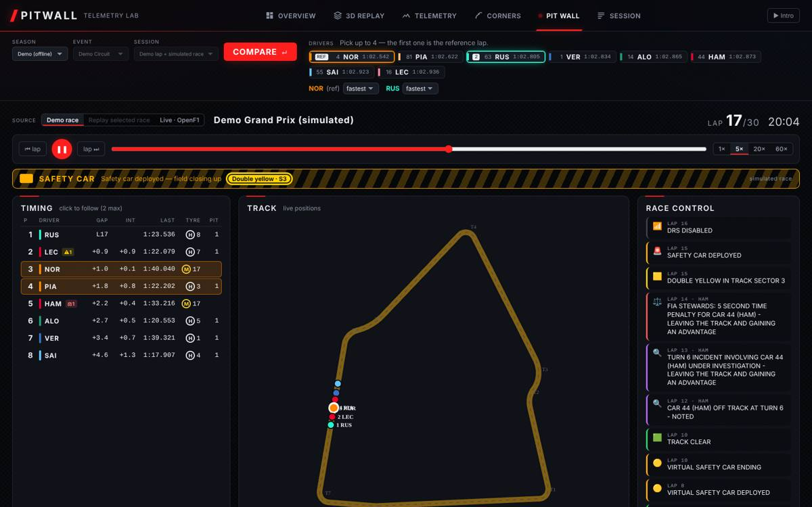
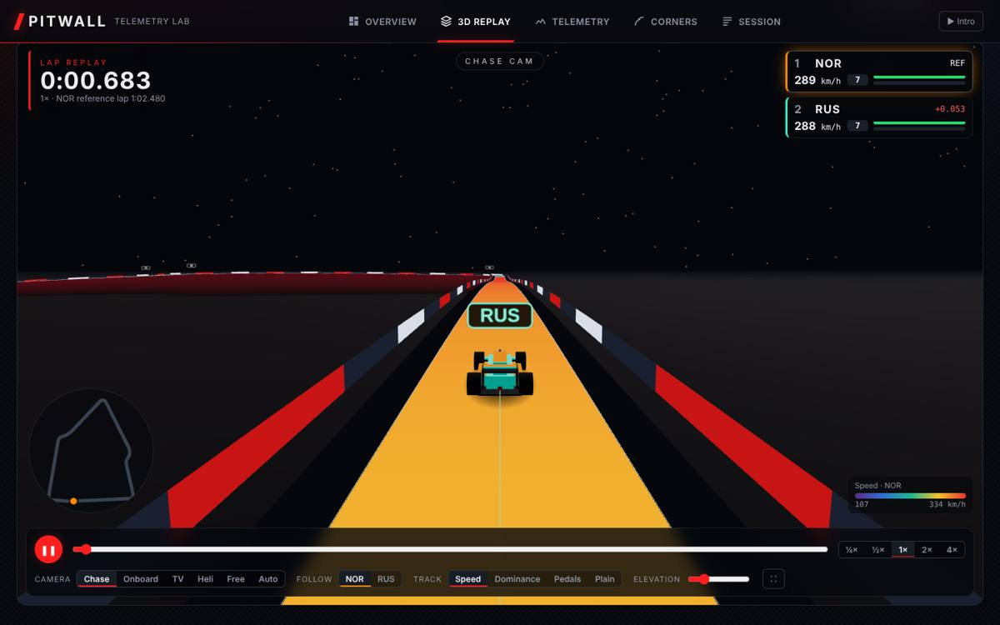

# Pitwall Telemetry

Built by Chetan Payyavula, with AI assistance (Claude) for the code.



Compare Formula 1 laps: speed / throttle / brake / gear traces, lap-time delta,
braking-zone table, speed map and track-dominance map. Data comes from the
official F1 live-timing feed through [FastF1](https://docs.fastf1.dev)
(2018 season onwards).

**Try it online: [chetan-payyavula.github.io/pitwall](https://chetan-payyavula.github.io/pitwall/)** (no install).
The online version has 8 recorded sessions from 2024 and 2026 and each driver's fastest lap,
and runs the same Python analysis code in your browser. Run it locally (below) for any session, any lap and live timing.

## Run it

```bash
cd f1-telemetry
python -m venv .venv
source .venv/bin/activate          # Windows: .venv\Scripts\activate
pip install -r requirements.txt
uvicorn backend.main:app --reload --reload-dir backend
```

On Windows you can just double-click `run.bat`. Open http://localhost:8000. It opens on the built-in **Demo** circuit (synthetic
data, works offline). Pick a season, event and session to load real data — the
first load of a session takes 30–60 s while FastF1 downloads it; after that it
is cached in `cache/` and loads in a second or two.

Run the tests with `pytest`.

## Online version (GitHub Pages, no server)

The `gh-pages` branch is a static build of the same app:

- Sessions are baked from the FastF1 cache into JSON (`tools/bake_static.py`): the session table,
  every driver's fastest-lap telemetry and, for races, the full replay data
  (car channels and session times stored losslessly; map positions as float32, under 1 mm error).
- `backend/service.py` holds the API logic shared by the server and the static build. In the browser it runs
  in a Web Worker on [Pyodide](https://pyodide.org) (Python + numpy + pandas compiled to WebAssembly), so lap
  comparisons are computed by the same code as the server.
- `tools/check_static.py` checks that the baked path gives the same answers as FastF1 (143 checks, all identical).
  In the browser, lap comparisons, session data and replay timing match exactly; the strategy model's fits can
  differ in the last rounded digit because Pyodide ships an older numpy.

Rebuild it:

```bash
F1_CACHE_DIR=cache python -m tools.bake_static site-data
F1_CACHE_DIR=cache python -m tools.check_static site-data
python -m tools.build_static_site site-data site      # then publish site/ to the gh-pages branch
```

## What's inside

| Tab | What you get |
|---|---|
| **Intro** | Boot log → five red lights → lights out → warp with shift lights → logo. Skip button, Esc/Enter/Space, "don't show again", optional synthesized sound, `?intro=0` / `?intro=1` in the URL, ▶ Intro button to replay it. |
| **Overview** | Event banner with weather, 3D-tilt driver cards (lap, gap, tyre, sectors, stat bars), auto-generated "race engineer's notes", sector-gap bars, track dominance map, speed map, animated top-speed gauges. |
| **3D Replay** | three.js track built from real X/Y/Z positions (elevation exaggeration slider), kerbs, barrier boards, start gantry, low-poly cars racing their real laps with brake glow, trails and labels. Cameras: chase, onboard, TV, helicopter, free orbit, auto director (keys 1–6). Track colouring: speed, dominance, pedals, plain. HUD with live order and gaps, speed/gear/pedals, mini-map, playback speed and scrubber (space = play/pause). |
| **Telemetry** | Speed, delta, throttle, brake, gear and RPM stacked on distance; hover moves dots on a mini-map and fills a live readout. G-G diagram, gear usage, speed distribution. |
| **Corners** | 3D coverflow — one slide per corner with mini-map, speed trace, brake points and entry/min/exit/time table (←/→ or swipe). Braking-zone table underneath. |
| **Pit Wall (live)** | Live timing tower (gap, interval with DRS window, last lap purple/green/deleted, tyre + age, stops, track-limit / penalty / investigation / blue-flag badges), live track map, race-control feed, flag banner (yellow sectors, VSC, SC, red), two driver dashboards (speed, gear, shift lights, throttle/brake, DRS, ERS battery estimate, 30 s trace). Strategy: tyre degradation per compound fitted live, pit loss under green/VSC/SC, rejoin predictor with gap ladder, undercut/overcut for every close battle, pit-window optimiser. Sources: built-in **demo race**, **replay** of any past race on its own clock (1×–60×, scrub, ±1 lap), or **OpenF1 live**. |
| **Session** | Weather, full classification with purple sectors, ideal laps and speed traps; race sessions add position chart, tyre strategy and race pace; other sessions get a lap-time scatter. |

## Live data — what is and isn't possible

* **Replay** (free): any race since 2018 via FastF1, played back as if live.
* **OpenF1 live**: real-time OpenF1 data needs an OpenF1 account (they ask for a
  sponsorship). Put your login in environment variables before starting:
  `set OPENF1_USERNAME=you@example.com` and `set OPENF1_PASSWORD=...` (Windows),
  then run `run.bat`. The server polls every 4 s and shows data ~4 s behind live.
* **Battery / ERS**: teams don't publish state of charge or deployment. The Pit
  Wall shows a clearly labelled *estimate* from speed, throttle and brake
  (harvest under braking/coasting, deploy on full throttle, per-lap budgets).
* Strategy numbers are models, not team data: fuel effect 0.055 s/lap, VSC pit
  loss ≈ 60 % and SC ≈ 50 % of green, tyre warm-up penalties — all constants
  at the top of `backend/strategy.py`.

## How it works

```
backend/
  main.py      FastAPI app: /api/schedule, /api/overview, /api/drivers, /api/compare + serves frontend/
  service.py   the API logic (compare, pit wall) shared by the server and the in-browser build
  static_data.py bake sessions to files, and read them back without FastF1 (online version)
  data.py      FastF1 loading (cached), drivers, lap telemetry, circuit corners, session overview
  analysis.py  pure maths: lap delta, braking zones, mini-sector dominance, g-forces, corner analysis
  demo.py      synthetic circuit with elevation, lap-time-sim speed profiles, race simulation
  livecore.py  live timing engine: one RaceData model → snapshot(t) (order, gaps, flags…)
  strategy.py  tyre deg, pit loss, rejoin, undercut/overcut, pit window, ERS estimate
  live_demo.py simulated race with VSC, SC, yellows, penalties, retirement
  live_sources.py FastF1 replay + OpenF1 live poller → RaceData
frontend/
  index.html, css/style.css
  js/main.js      app shell: pickers, tabs, URL state
  js/intro.js     opening sequence (canvas + Web Audio)
  js/track3d.js   3D replay (three.js)
  js/charts.js    overview + telemetry charts (Plotly)
  js/corners.js   corner coverflow + braking table
  js/session.js   classification, traps, race charts
  js/live.js      Pit Wall tab
  js/static-api.js, js/static-worker.js  online version: answers the API from baked files + Pyodide
  vendor/         plotly, three.js, OrbitControls (no CDN, no build step)
tests/         analysis maths, API, and the FastF1 code path with a fake session
tools/         bake, check and build the online version
```

**Lap delta** — both laps are interpolated onto a shared 5 m distance grid and
the elapsed times subtracted. Positive = slower than the reference (first driver).

**Braking zones** — taken from the brake on/off channel. Signal flicker under
15 m is merged, blips that don't cost ≥10 km/h are ignored, and the minimum
speed is searched past brake release (the apex is usually after it).

**Track dominance** — the lap is cut into equal-distance mini-sectors and each
is coloured by the driver who spent the least *time* in it.

**G-forces** — longitudinal from dv/dt, lateral from v² × path curvature. XY is
converted to metres by comparing path length with distance, so FastF1's
decimetre positions and the demo's metres give the same answer.

## API

| Endpoint | Example |
|---|---|
| `GET /api/schedule?year=2024` | events with sessions that have run |
| `GET /api/overview?year=2024&event=16&session=Qualifying` | classification, sectors, speed traps, every lap, weather |
| `GET /api/drivers?year=2024&event=16&session=Qualifying` | drivers, team colours, best laps |
| `GET /api/live/snapshot?source=replay&year=2024&event=16&session=Race&t=4000&focus=LEC,PIA` | timing screen at session time t |
| `GET /api/live/strategy?source=replay&year=2024&event=16&session=Race&t=4000&focus=LEC` | deg, pit loss, rejoin, battles, pit window, ERS |
| `GET /api/compare?year=2024&event=16&session=Qualifying&drivers=LEC,NOR&laps=fastest,fastest` | everything the dashboard draws |

`year=0` uses the demo circuit. `event` is a round number or event name.
Interactive docs: http://localhost:8000/docs.

## Ideas for next steps

- Race mode: lap-time chart, tyre stints, position changes
- Corner-by-corner minimum-speed bar chart
- Throttle/brake overlap ("trail braking") metric
- Deploy: one Docker container (`uvicorn backend.main:app --host 0.0.0.0`)
  with a persistent volume for `cache/`

## Screenshots




